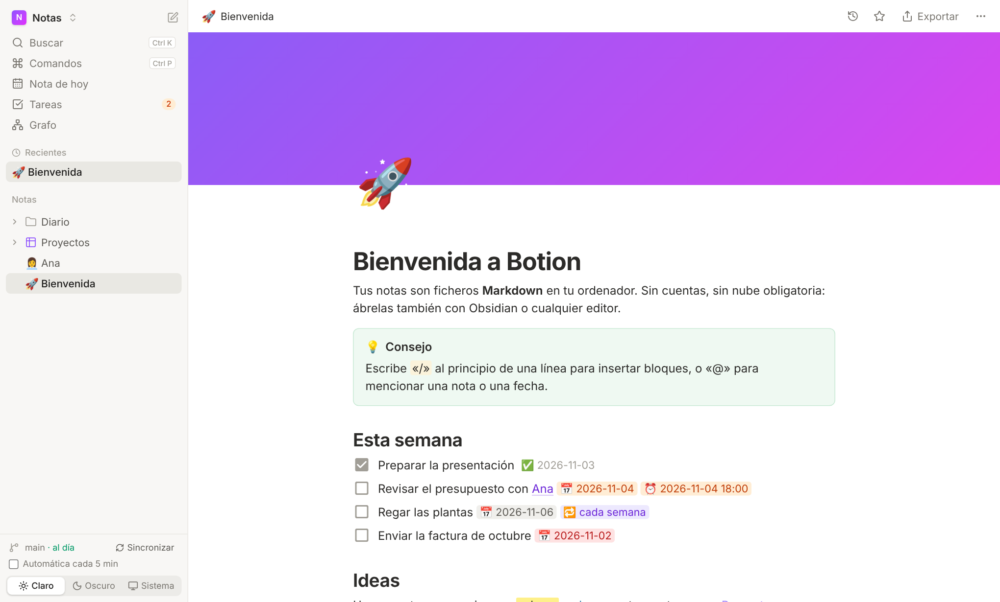
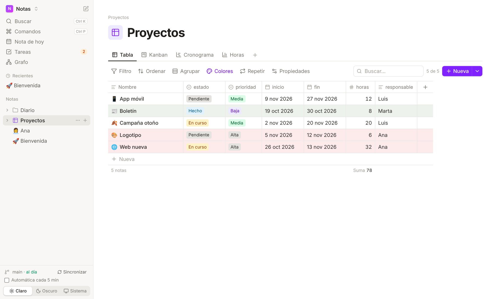
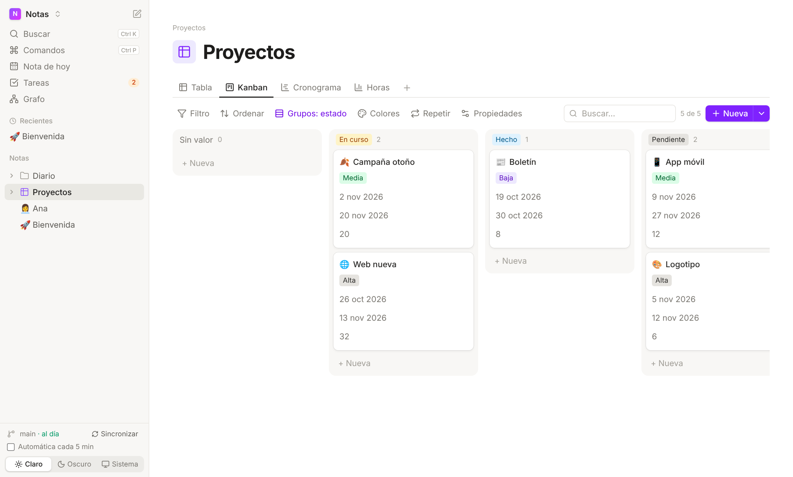
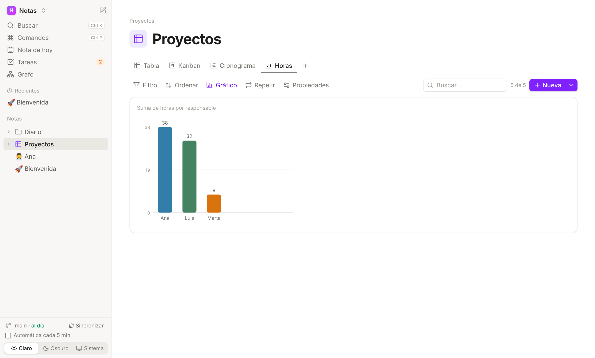
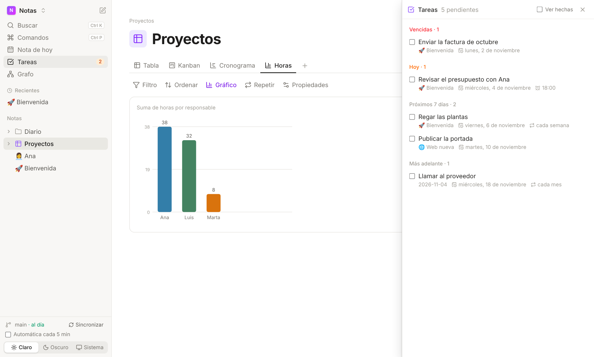
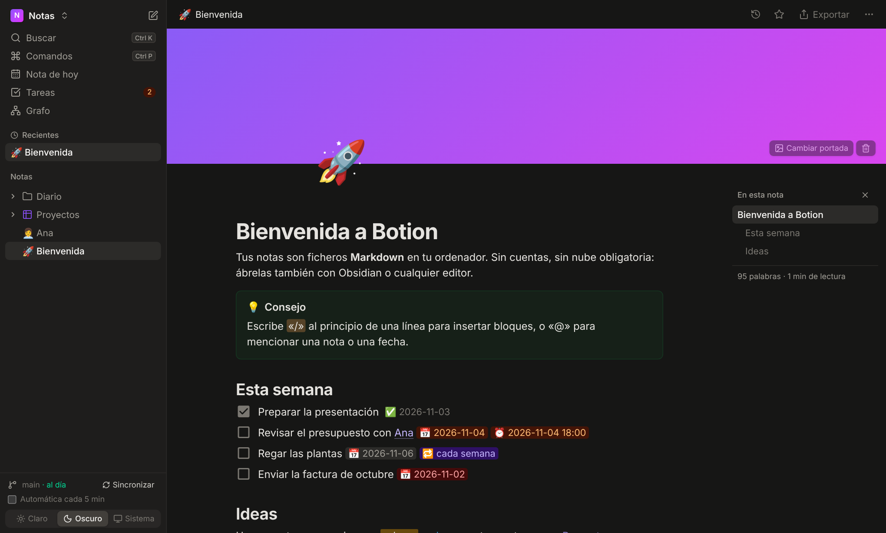
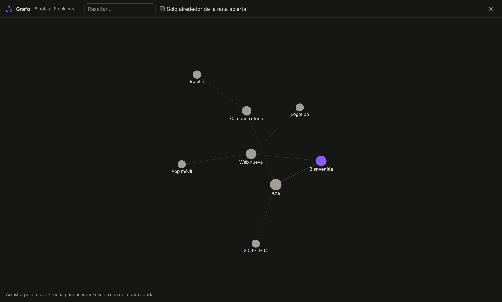

# Botion

App de escritorio local para tomar notas, inspirada en [Notion](https://www.notion.so) y [Obsidian](https://obsidian.md). Tus notas son ficheros `.md` normales en una carpeta de tu ordenador, con funciones tipo Notion: editor visual, enlaces entre notas y bases de datos con varias vistas.

- **Local:** sin cuenta, sin servidor y sin internet. Para Windows, macOS y Linux.
- **Tus datos son tuyos:** notas Markdown normales, compatibles con Obsidian.
- **Descargar:** última versión en [Releases](https://github.com/WwagnerPO/Botion/releases/latest).



## Índice

- [Capturas](#capturas)
- [Qué hace](#qué-hace)
- [Uso](#uso)
  - [macOS: «Botion está dañado y no se puede abrir»](#macos-botion-está-dañado-y-no-se-puede-abrir)
  - [Comandos /](#comandos-)
  - [Atajos](#atajos)
  - [Navegación](#navegación)
  - [Escribir](#escribir)
  - [Tareas y recordatorios](#tareas-y-recordatorios)
  - [Icono y portada](#icono-y-portada)
  - [Imágenes, archivos y exportar](#imágenes-archivos-y-exportar)
  - [Organizar](#organizar)
  - [Bases de datos](#bases-de-datos)
  - [Plantillas](#plantillas)
  - [Sincronizar sin Git](#sincronizar-sin-git)
  - [Importar desde Notion](#importar-desde-notion)
  - [Sincronización con Git](#sincronización-con-git)
- [Pendiente](#pendiente)
- [Desarrollo](#desarrollo)
- [Licencia](#licencia)
  - [Contribuciones](#contribuciones)

## Capturas

| | |
|---|---|
|  |  |
| **Tabla** con formato condicional y totales | **Kanban**: arrastra para cambiar el estado |
|  |  |
| **Gráfico** a partir de la base de datos | **Tareas** con fecha de toda la bóveda |
|  |  |
| **Tema oscuro** e índice lateral | **Grafo** de enlaces |

## Qué hace

- Editor visual con comandos `/`, enlaces `[[nota]]`, menciones `@`, backlinks, pestañas, vista dividida y grafo.
- Bases de datos: cada carpeta es una tabla y cada nota una fila. Vistas de tabla, kanban, calendario, galería, lista, cronograma y gráfico, con filtros, fórmulas, relaciones y colores.
- Tareas con fecha, recordatorios y repeticiones; nota diaria; fechas en lenguaje natural.
- PDF con subrayados, bloques sincronizados, comentarios, colores, columnas y notas al pie.
- Notas cifradas, recortador web, atajos de Vim, importar desde Notion.
- Sincronización con Git, WebDAV o una carpeta en la nube, con historial y conflictos resueltos en la app.
- Se actualiza sola.

## Uso

### macOS: «Botion está dañado y no se puede abrir»

Pasa con las apps descargadas que no tienen certificado de Apple. No está dañada: macOS la bloquea por venir de internet.

1. Mueve `Botion.app` a **Aplicaciones**.
2. Abre **Terminal** y ejecuta: `xattr -cr /Applications/Botion.app`
3. Ábrela normalmente.

La app va firmada «ad hoc» (sin certificado): si aun así avisa, clic derecho en Botion → **Abrir** → **Abrir**.

### Comandos `/`

Escribe `/` al principio de una línea vacía para abrir el menú de bloques. Puedes seguir escribiendo para filtrar, con o sin tildes (por ejemplo `/fecha` o `/titulo`).

| Grupo | Comandos |
|-------|----------|
| Texto | Texto, Título 1–6, Cita, Separador |
| Listas | Lista con viñetas, Lista numerada, Lista de tareas |
| Avanzado | Código, Tabla, Fórmula |
| Botion | Página (crea una nota y la enlaza), Mención, Nota de hoy, Imagen, Vídeo, Audio, Archivo (los PDF se ven en la nota), YouTube, Emoji, Icono de la página, Portada, Incrustar nota, Bloque sincronizado, Vista de base de datos, Botón, Enlace a nota, Propiedad, Base de datos, Plantilla, Aviso (nota, consejo, aviso, peligro), Desplegable, Índice, Resaltar, Color, Comentario, Nota al pie, 2 columnas, 3 columnas, Diagrama, Exportar a PDF, Exportar a HTML, Fecha de hoy, Hora actual, Fecha de vencimiento, Recordatorio, Repetir tarea, Ancho completo, Texto pequeño, Fuente (normal, serif, monoespaciada), Índice lateral, Modo sin distracciones, Atajos de Vim, Cifrar nota, Recortar web |

Todo se guarda con sintaxis compatible con Obsidian:

| Función | Markdown |
|---------|----------|
| Aviso / desplegable | `> [!tip] Título` / `> [!note]- Título` |
| Índice | lista de `[[#título]]` |
| Resaltar | `==texto==` (también `Ctrl+Mayús+H` o el botón de la barra de formato) |
| Incrustar nota | `![[nota]]` en una línea propia |
| Vista de base de datos | `![[Carpeta/]]` (con barra final; solo Botion la dibuja) |
| Diagrama | bloque de código `mermaid`, con vista previa |
| Imagen | `` |
| Vídeo, audio o archivo | `![[adjuntos/clip.mp4]]` (se reproduce o se abre con su programa) |
| YouTube | `` (miniatura; se abre en el navegador) |
| Icono y portada | `icono: 🚀` y `portada: violeta` en el frontmatter |
| Estilo de la página | `fuente: serif`, `ancho_completo: true`, `texto_pequeño: true` en el frontmatter |
| Color de texto o fondo | `<span style="color: #d44c47">texto</span>` (también `background-color`) |
| Comentario | `%%texto del comentario%%` (Obsidian no lo enseña al leer) |
| Nota al pie | `texto[^1]` y `[^1]: nota` al final |
| Columnas | `> [!multi-column]` con `> > [!blank]` dentro (como el fragmento «Modular CSS Layout») |
| Tarea con fecha | `- [ ] Pagar 📅 2026-10-31 ⏰ 2026-10-30 09:00 🔁 cada mes` (como el plugin Tasks) |
| Bloque sincronizado | `![[Nota#^abc123]]`; el bloque original acaba en ` ^abc123` |
| Botón | bloque de código `boton` con `texto:`, `base:`, `plantilla:`, `abrir:` y propiedades |
| Nota cifrada | bloque de código `botion-cifrado` (AES-GCM); las propiedades no se cifran |
| Página recortada | nota en `Recortes/` con `fuente:` y `recortado:` en el frontmatter |

### Atajos

| Atajo | Acción |
|-------|--------|
| `Ctrl+K` | Buscar notas |
| `Ctrl+P` | Paleta de comandos |
| `Ctrl+F` | Buscar en la nota (`Enter` / `Mayús+Enter` para moverse) |
| `Ctrl+N` | Nueva nota |
| `Ctrl+Mayús+H` | Resaltar |
| `Ctrl+.` | Modo sin distracciones |
| `@` | Mencionar una nota o una fecha |
| `Ctrl+clic` | Abrir en pestaña nueva |
| `Alt+clic` | Abrir a la derecha (dos notas lado a lado) |
| `Ctrl+W` | Cerrar pestaña |
| `Ctrl+Tab` / `Ctrl+Mayús+Tab` | Pestaña siguiente / anterior |

En macOS, `Cmd` en lugar de `Ctrl`.

### Navegación

- **Pestañas:** `Ctrl+clic` en una nota (o clic derecho → «Abrir en pestaña nueva»). El clic normal cambia la pestaña activa.
- **Dos notas lado a lado:** `Alt+clic` o clic derecho → «Abrir a la derecha». Cada una se guarda sola.
- **Favoritas y recientes:** la estrella de arriba a la derecha de la nota la añade a «Favoritas»; las últimas abiertas salen en «Recientes».
- **Grafo:** en la barra lateral. Cada nota es un punto y cada enlace una línea; «Solo alrededor de la nota abierta» muestra su entorno.
- **Historial:** el reloj de arriba a la derecha. Muestra las versiones guardadas con Git (al sincronizar o con «Guardar versión ahora») y permite restaurar una.
- **Convertir en…:** pulsa el asa ⋮⋮ a la izquierda de un bloque para convertirlo (texto, títulos, listas, cita, código), duplicarlo o eliminarlo. Arrástrala para moverlo.

### Escribir

- **Estilo de la página:** el botón «…» de arriba a la derecha cambia la fuente (normal, serif, mono), el texto pequeño y el ancho completo. Ahí también están el recuento de palabras y el tiempo de lectura.
- **Índice lateral:** en «…» o `/Índice lateral`. Muestra los títulos de la nota y marca por dónde vas.
- **Modo sin distracciones:** `Ctrl+.` oculta la barra lateral, las pestañas y los enlaces; la barra de arriba aparece al pasar el ratón.
- **Nota de hoy:** en la barra lateral o la paleta de comandos. Crea `Diario/2026-10-30.md` con la plantilla «Diario» si existe (`Plantillas/Diario.md`). `/Nota de hoy` la enlaza.
- **Colores:** selecciona texto y pulsa el botón de color de la barra (o `/Color` para todo el párrafo).
- **Comentarios:** botón «Comentar» de la barra o `/Comentario`. Se ven como 💬 en el texto y, si hay sitio, en el margen derecho.
- **Bloques sincronizados:** asa ⋮⋮ → «Copiar como bloque sincronizado» y pega en otra nota, o `/Bloque sincronizado` para elegir nota y bloque. Al editarlo en cualquier sitio cambia en la nota original.
- **PDF:** `/Archivo` con un PDF lo muestra en la nota. Selecciona texto y pulsa «Subrayar»; los subrayados se guardan en «nombre (subrayados).md», junto al PDF, y cada uno se puede incrustar en otra nota.
- **Recortar web:** paleta de comandos → «Recortar página web» o `/Recortar web`. Descarga la página, se queda con el artículo (sin menús ni anuncios) y lo guarda en Markdown en `Recortes/`, con la dirección de origen. Las imágenes siguen en la web.
- **Notas cifradas:** `/Cifrar nota` o la paleta. Pide una contraseña; en disco solo queda el texto cifrado (AES-GCM, clave derivada con PBKDF2). Al abrirla pide la contraseña, que se recuerda hasta cerrar la app; el candado de arriba la bloquea otra vez y «Quitar el cifrado» la deja normal. **Si olvidas la contraseña, no se puede recuperar.**
- **Atajos de Vim:** `/Atajos de Vim` o la paleta. Modo normal: `h j k l`, `w b e`, `0 ^ $`, `gg G`, `x`, `dd`, `u`, `Ctrl+R`; para escribir: `i a I A o O`; `Esc` vuelve a normal. Abajo se ve el modo.
- **Fechas en lenguaje natural:** en `@`, `/Fecha de vencimiento` y `/Recordatorio` vale escribir «mañana», «el viernes», «dentro de 3 días», «15 de noviembre a las 18:30»…

### Tareas y recordatorios

- `/Fecha de vencimiento`, `/Recordatorio` y `/Repetir tarea` añaden la marca al final de una tarea (`- [ ]`).
- «Tareas» en la barra lateral junta las tareas con fecha de toda la bóveda: vencidas, hoy, próximos 7 días y más adelante. Se pueden marcar desde ahí.
- Los recordatorios avisan con una notificación del sistema mientras Botion está abierto (sin hora, a las 9:00).
- Al marcar una tarea con 🔁 se apunta cuándo se hizo (`✅ fecha`) y se crea encima la siguiente, con las fechas movidas. Reglas: «cada día», «cada día laborable», «cada semana», «cada 2 semanas», «cada mes», «cada año», «cada lunes y jueves»…

### Icono y portada

Pasa el ratón sobre la cabecera de la nota y pulsa «Añadir icono» o «Añadir portada» (o usa `/Icono de la página` y `/Portada`). El icono también se ve en la barra lateral.

- **Icono:** cualquier emoji; el selector busca en español («cohete», «libro»…).
- **Portada:** un color (`violeta`, `atardecer`, `océano`, `bosque`, `arena`, `noche`, `rosa`, `niebla`) o una imagen subida a `adjuntos/`.

### Imágenes, archivos y exportar

- Pega o arrastra una imagen en la nota (o usa `/Imagen`): se guarda en la carpeta `adjuntos/` de la bóveda y se enlaza con una ruta relativa.
- Igual con vídeos, audios y otros archivos (`/Vídeo`, `/Audio`, `/Archivo`): los vídeos y audios se reproducen en la nota; el resto se abre con su programa.
- «Exportar» (arriba a la derecha de la nota) o `/Exportar a…`:
  - **HTML:** un único fichero con las imágenes y los diagramas dentro.
  - **PDF:** abre el diálogo de imprimir; elige «Guardar como PDF».

### Organizar

- Arrastra notas o carpetas sobre otra carpeta para moverlas (o a una zona vacía para llevarlas a la raíz). Los enlaces se actualizan solos.
- Al pasar el ratón por una carpeta, `+` crea una nota dentro y `…` abre el mismo menú que el clic derecho (también «Mostrar en el explorador»).

### Bases de datos

Cualquier carpeta puede ser una base de datos (clic derecho → «Convertir en base de datos», o `/Base de datos` desde una nota):

- Cada nota de la carpeta es una fila; sus propiedades (frontmatter) son las columnas.
- Los datos están en las notas. La carpeta solo guarda la configuración en un fichero oculto `.botion-db.json`.
- Pulsa el nombre de una fila para abrirla en un **panel lateral** (propiedades editables y texto de la nota) o «Abrir» para ir a la página.

#### Vistas

Cada base de datos puede tener varias vistas guardadas (pestañas encima de la tabla), cada una con sus filtros, orden, grupos y columnas visibles. Pulsa la pestaña activa para renombrarla, cambiar su tipo, duplicarla o eliminarla.

| Vista | Qué muestra |
|-------|-------------|
| Tabla | Edición directa de cada celda, grupos plegables y totales al pie |
| Kanban | Una columna por valor de una propiedad; arrastra para cambiarlo |
| Calendario | Las notas en el día de una fecha; arrastra para moverlas |
| Galería | Tarjetas con la portada o el icono de cada nota |
| Lista | Una línea por nota con sus propiedades a la derecha |
| Cronograma | Barras entre una fecha de inicio y otra de fin; arrastra la barra o su borde |
| Gráfico | Barras, líneas o tarta: filas agrupadas por una propiedad (las fechas, por mes), contadas o con la suma, media, mínimo o máximo de otra |

En la barra de la vista:

- **Filtro:** condiciones por propiedad («estado es Hecho», «precio > 10», «fecha en la próxima semana»…). Se cumplen todas a la vez.
- **Ordenar** y **Agrupar** por cualquier propiedad.
- **Colores:** formato condicional; colorea las filas que cumplen una condición («estado es Hecho» → verde).
- **Repetir:** tareas que se repiten. Al marcar una fila como hecha, su fecha avanza según la regla de otra columna («cada semana») y vuelve a quedar pendiente.
- **Propiedades:** mostrar u ocultar columnas en esta vista, e «Incluir subcarpetas».
- En la tabla, arrastra el borde de una cabecera para cambiar el ancho y la cabecera entera para reordenar. Pulsa el pie de una columna para elegir un total (contar, suma, media, mediana, mínimo, máximo, % marcadas…).

#### Tipos de propiedad

Texto, Número, Casilla, Fecha, Selección, Etiquetas, URL, Email, Teléfono, Archivos (adjuntos en `adjuntos/`), Relación, Rollup, Fórmula, Fecha de creación y Última edición. Pulsa la cabecera de una columna para cambiar su nombre o su tipo.

- **Relación:** enlaza filas de otra base de datos. Se guarda como en Obsidian: `proyectos: ["[[Web]]", "[[App]]"]`.
- **Rollup:** resume una propiedad de las filas relacionadas (contar, suma, media, mínimo, máximo, fechas…).
- **Fórmula:** se calcula para cada fila y no se guarda en las notas. Ejemplos:

  ```text
  prop("precio") * prop("cantidad")
  if(prop("hecha"), "✅", "⏳")
  dateBetween(prop("fin"), today(), "days")
  concat(upper(prop("estado")), " · ", formatDate(prop("fecha")))
  ```

  Funciones: `if`, `and`, `or`, `not`, `empty`, `length`, `concat`, `join`, `contains`, `lower`, `upper`, `trim`, `replace`, `replaceAll`, `substring`, `format`, `toNumber`, `round`, `floor`, `ceil`, `abs`, `sqrt`, `pow`, `min`, `max`, `sum`, `average`, `now`, `today`, `dateAdd`, `dateSubtract`, `dateBetween`, `formatDate`, `year`, `month`, `day`, `weekday`. Operadores: `+ - * / %`, `== != < <= > >=`, `and`/`&&`, `or`/`||`, `not`/`!`.

#### Plantillas y botones

- La flecha de «Nueva» abre las plantillas de la base de datos: «Nueva plantilla» crea una nota (en la carpeta oculta `.plantillas`) con el texto y las propiedades de partida; el lápiz la edita.
- `/Botón` en cualquier nota añade un botón que crea una fila en una base de datos, con propiedades ya puestas o desde una plantilla:

  ```boton
  texto: Nueva tarea
  base: Tareas
  plantilla: Tarea
  abrir: sí
  estado: Pendiente
  ```

Las notas muestran sus propiedades encima del texto y se pueden editar ahí también. Al editarlas se conservan los comentarios y el formato del resto del frontmatter.

### Plantillas

Las plantillas son notas normales de la carpeta `Plantillas`. Úsalas con `/Plantilla` (inserta el contenido en la nota abierta y le añade las propiedades que falten) o con clic derecho → «Nueva nota desde plantilla».

Variables que se sustituyen al usarlas: `{{titulo}}`, `{{fecha}}` y `{{hora}}`.

### Sincronizar sin Git

- **Carpeta en la nube o Syncthing:** pon la bóveda dentro de Dropbox, iCloud Drive, OneDrive, Google Drive o una carpeta de Syncthing. Si una nota cambia en dos sitios a la vez, esos programas dejan una copia («conflicted copy», `.sync-conflict-…`): Botion la detecta, avisa al pie de la barra lateral y en «Conflictos» deja compararlas una al lado de otra y elegir (la mía, la copia o las dos).
- **WebDAV** (Nextcloud, ownCloud, Synology, Fastmail…): paleta de comandos → «Sincronizar con WebDAV». Pon la dirección de una carpeta del servidor, tu usuario y una contraseña de aplicación. Sube lo que cambió aquí, baja lo que cambió allí y, si cambió en los dos sitios, guarda la del servidor como «nota (conflicto WebDAV)» para elegir después. Puede hacerse sola cada 5 minutos.
  - Los ajustes se guardan en la carpeta de configuración de Botion de este ordenador, no en la bóveda (la contraseña, sin cifrar: usa una contraseña de aplicación que puedas revocar).

### Importar desde Notion

1. En Notion: «Settings» → «Export all workspace content» (o «Export» en una página) con formato **Markdown & CSV** e «Include subpages».
2. En Botion: paleta de comandos → «Importar desde Notion (.zip)» (o «Importar carpeta exportada» si ya la descomprimiste).
3. Todo queda en «Importado de Notion»: los nombres sin los códigos de Notion, los enlaces como `[[nota]]`, las imágenes y adjuntos con sus rutas, y cada tabla como base de datos con sus columnas en las propiedades (fechas, casillas, números y relaciones incluidas).

### Sincronización con Git

Opcional. Al pie de la barra lateral:

1. «Activar historial con Git» convierte la bóveda en un repositorio (si no lo era) y guarda una primera versión.
2. Para sincronizar entre ordenadores, añade un remoto con Git (por ejemplo `git remote add origin git@github.com:tu-usuario/notas.git`).
3. «Sincronizar» guarda los cambios, baja los del remoto y sube los tuyos. También puede hacerse solo cada 5 minutos.

Usa el `git` instalado en tu sistema y sus credenciales (SSH o gestor de credenciales); Botion nunca pide contraseñas.

Si dos ordenadores cambian la misma parte de una nota, Botion pregunta qué hacer:

- **Guardar las dos:** mantiene la tuya y guarda la otra como «nota (remoto).md».
- **Quedarme con la mía** o **usar la del otro ordenador**.
- **Decidir más tarde:** tus cambios quedan guardados en Git y no se pierde nada.

Lo que no choca se une solo.

## Pendiente

- [ ] Probar en un Mac de verdad: vídeo, audio, YouTube, recordatorios, PDF, recortes, notas cifradas, WebDAV e importar desde Notion.
- [ ] App para el móvil que abra la misma bóveda.
- [ ] Firmar los instaladores (necesita certificados de pago; ver [DESARROLLO.md](DESARROLLO.md#firmar-los-instaladores-opcional)).

## Desarrollo

Compilar, probar, publicar versiones, actualizaciones automáticas y firma de instaladores: ver [DESARROLLO.md](DESARROLLO.md).

## Licencia

Botion tiene doble licencia; puedes elegir la que prefieras:

- [MIT](LICENSE-MIT)
- [Apache 2.0](LICENSE-APACHE)

Incluye la fuente [Inter](https://rsms.me/inter/) (SIL Open Font License 1.1) y los iconos de [Lucide](https://lucide.dev) (ISC).

### Contribuciones

Salvo que indiques lo contrario, cualquier contribución que envíes para incluirla en Botion se publicará bajo esta misma doble licencia (MIT o Apache 2.0), sin términos adicionales.

Botion es un proyecto independiente y no está afiliado a Notion Labs, Inc. ni a Obsidian.
